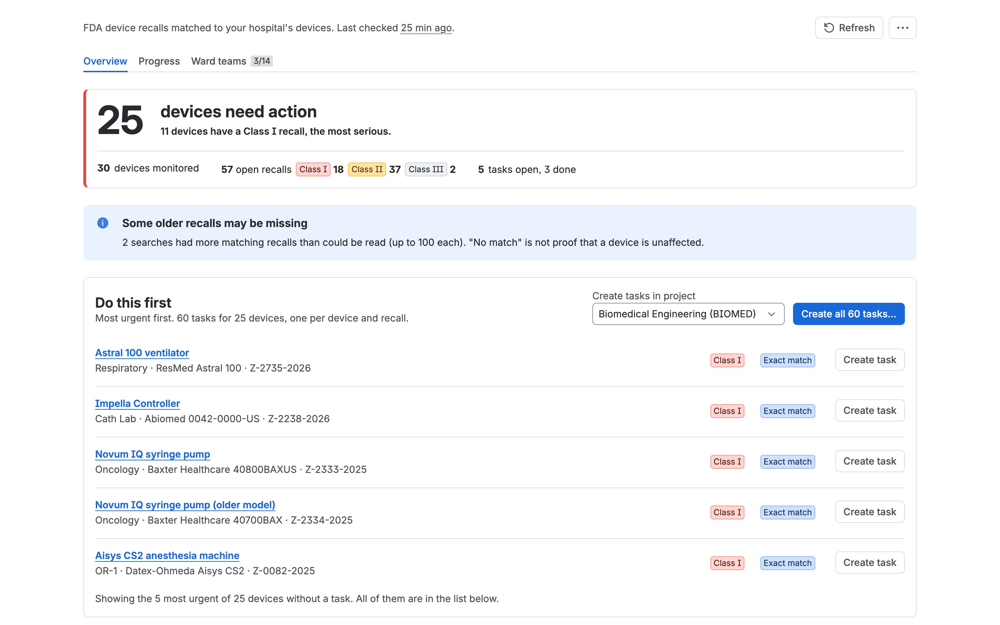

# RecallRadar

A Forge app for hospital teams. It compares **FDA medical device recalls** ([openFDA](https://open.fda.gov/apis/device/enforcement/)) with the devices a hospital owns and says which devices a recall may affect, **how sure it is, and why**. Every match becomes a Jira task due by the recall's class.

**Why it matters.** A Class I recall can mean serious harm or death. New recalls appear every week and clinical engineering teams match them to their own devices by hand. Those teams already work in Jira, so the proof and the follow-up belong there.

*Screenshots are generated from the app with invented demo data (25 devices, 60 tasks). On a live site the counts follow the day's FDA data: the production demo showed 26 devices on 18 Nov.*

It runs as a Jira dashboard and issue panel, as a **Rovo agent**, as **MCP tools** for other agents, and it reads **teams from the Teamwork Graph** (read-only) to say who handles a ward.

## Judge path (2 minutes)

**Install link:** [Install RecallRadar on your site](https://developer.atlassian.com/console/install/2e0464e9-8b4a-4388-b224-b4f05eae484f?signature=AYABeO4RTK5WoBjofwC5LLmbhsYAAAADAAdhd3Mta21zAEthcm46YXdzOmttczp1cy13ZXN0LTI6NzA5NTg3ODM1MjQzOmtleS83MDVlZDY3MC1mNTdjLTQxYjUtOWY5Yi1lM2YyZGNjMTQ2ZTcAuAECAQB4CxqLTo9l4lqXuFjNim1xJM%2Bp%2F3TVP9xHS2BrU5DRRucBww%2B9LK1oIgu9liOwPhgsXAAAAH4wfAYJKoZIhvcNAQcGoG8wbQIBADBoBgkqhkiG9w0BBwEwHgYJYIZIAWUDBAEuMBEEDHKMnOskwi5OXx%2FzLgIBEIA7zuERvhMx7ShEsGkCJm5Z8hk9ed%2Bt7tGaDRXY7BfQDQgmbBI9ZRnlrKpIjin2Om5ZKyqwiB1JHcdqFnsAB2F3cy1rbXMAS2Fybjphd3M6a21zOmV1LXdlc3QtMTo3MDk1ODc4MzUyNDM6a2V5LzQ2MzBjZTZiLTAwYzMtNGRlMi04NzdiLTYyN2UyMDYwZTVjYwC4AQICAHi9bVMAkme4qVQX1fQHo6ePw3H40A7cGfz7yrmSfBWMXgGys7iVbyvKbXxP2R%2BERAnvAAAAfjB8BgkqhkiG9w0BBwagbzBtAgEAMGgGCSqGSIb3DQEHATAeBglghkgBZQMEAS4wEQQM%2FVNU%2BxfhXtpy4%2BeYAgEQgDsvKNiIJmQha%2FJR9MFVh%2BPee9MRb%2BS8yIpLzcQKBiEpJmV5m14bJnObCM285wbWwmXa80cIEai5oxRxNQAHYXdzLWttcwBLYXJuOmF3czprbXM6dXMtZWFzdC0xOjcwOTU4NzgzNTI0MzprZXkvNmMxMjBiYTAtNGNkNS00OTg1LWI4MmUtNDBhMDQ5NTJjYzU3ALgBAgIAeDYASx0XCjkny4iLV6vz%2BKtEGSGT6kdt0QRpkn6D%2FlVEATS%2Bkr01q3xokP63tO9y6hEAAAB%2BMHwGCSqGSIb3DQEHBqBvMG0CAQAwaAYJKoZIhvcNAQcBMB4GCWCGSAFlAwQBLjARBAydBB73g1k8hMBXv2oCARCAO39zZoIuJS%2BmBrVEmrJ6IgA8F1fJ1zjpKdaHLgS0A2U1ATDnB8LEBbE99JXX4bf6vnTBM2yrpM%2BXFlGLAgAAAAAMAAAQAAAAAAAAAAAAAAAAACbRvGQFLeROV2zy2GClH%2F%2F%2F%2F%2F%2F%2FAAAAAQAAAAAAAAAAAAAAAQAAADJywqnoXY3ILklDld%2FHhPDyQrscgOSY0SSFTsEKQ8eo%2B3drtTsSIsOcDlwi9SCsXCp%2FHu8jd30aniNvAEKK7u5gOqM%3D&product=jira&product=confluence)

1. Install it in **Jira** (one installation per site; **Confluence** is an optional extra, see [installation](docs/INSTALLATION.md)). You need to be a Jira administrator.
2. Jira, **Apps**, **RecallRadar**, **Load demo hospital** (30 devices with real maker and model names). The check takes about 35 seconds.
3. Read the headline, click a device in **Do this first**: the recall, what the FDA says is wrong, and the reason for the match.
4. **Create all N tasks...** (one task per affected device and recall; never twice for the same pair). Delete them later with the Jira search `labels = recallradar`.
5. Optional: **Ask Rovo**, pick *RecallRadar Assistant*: "Which Cath Lab devices have open Class I recalls?" Rovo needs a site that has it (a free developer site does not).

Needs from a judge: Jira administrator rights; **Ward teams** needs you to be in a team; **Confluence pages** need the optional connection; **MCP** needs an admin to switch the app's tools on ([steps](docs/mcp-demo.md)).

**Known limits, up front.** Devices come from the demo, a pasted spreadsheet or a read-only JSM Assets object type, not a CMMS. Accuracy was measured on recalls and labels the author wrote, not on a real hospital ([ACCURACY](docs/ACCURACY.md)). The app calls api.fda.gov, so it is not eligible for "Runs on Atlassian". The MCP connection from Claude Desktop has not been run end to end. Full list: [what was and was not verified](docs/VERIFICATION.md).

## Where things are

| Page | What is in it |
| --- | --- |
| [`docs/FEATURES.md`](docs/FEATURES.md) | How matching works, the background check, tasks, Teamwork Graph, Rovo agent, MCP, Confluence pages |
| [`docs/VERIFICATION.md`](docs/VERIFICATION.md) | What was and was not verified live, by date |
| [`docs/ACCURACY.md`](docs/ACCURACY.md) | Precision and recall on 3,438 labeled pairs, and the head-to-head with a keyword matcher |
| [`docs/MATCHING.md`](docs/MATCHING.md) | Each fact check, every threshold and why, ordering, known limits |
| [`docs/ACCURACY.md`](docs/ACCURACY.md) | Precision and recall per match level on 3,438 labeled pairs from 48 real recalls (including recalls with several products, with exclusions and with maker aliases), every wrong pair, the limits of the measurement |
| [`docs/ARCHITECTURE.md`](docs/ARCHITECTURE.md) | The background check job, its rules and measurements |
| [`docs/TASKS.md`](docs/TASKS.md) | The due-date rule, how duplicates are prevented, tracking tasks to closure, limits |
| [`docs/ALERTS.md`](docs/ALERTS.md) | What "new" means, what the daily run does, who it acts as, what it stores, limits |
| [`docs/TEAMWORK_GRAPH.md`](docs/TEAMWORK_GRAPH.md) | The four Teamwork Graph queries verbatim, what is stored, what was verified |
| [`docs/MCP.md`](docs/MCP.md) | Connecting Claude Desktop, Claude Code, Cursor and others |
| [`docs/DEVELOPMENT.md`](docs/DEVELOPMENT.md) | Demo hospital, project layout, build, deploy, tests |
| [`docs/INSTALLATION.md`](docs/INSTALLATION.md) | One installation for Jira, Confluence and Rovo Home, and connecting Confluence |

## Develop

Node 22+ and the Forge CLI. `npm install`, `npm test` (unit tests, no network), `npm run typecheck` (the JSDoc types, checked by `tsc`: the core matching code strictly), `npm run test:ui`, `npm run test:preview` (the real bundle in headless Chrome). The app is multi-app compatible (Jira required, Confluence optional): install it in Jira first, then connect Confluence. Everything else, including the project layout: [`docs/DEVELOPMENT.md`](docs/DEVELOPMENT.md).

## Permissions

| Scope / permission | Why |
| --- | --- |
| `read:jira-work` | Jira issue panel; finding existing RecallRadar tasks. |
| `write:jira-work` | Creating tasks (as the clicking user). |
| `read:space:confluence`, `read:page:confluence`, `write:page:confluence` | The Confluence recall pages: list spaces, find a page by title, create or update it (as the person chatting). |
| `read:graph:team:atlassian`, `read:graph:user:atlassian` | Teams a person is in, the members of a team, and (for the project lead) a person's name: read-only Teamwork Graph queries, run as the signed-in person. |
| `read:graph:project:jira`, `read:graph:issue:jira` | The Jira projects a team is linked to (and each project's lead) and the Jira work assigned to a person, for the recall drawer's "Who handles this ward" card. Read-only, as the signed-in person; the graph returns only what that person may see. |
| `storage:app` | The device list, the saved check, and the ward-to-team mapping in Forge storage. |
| External fetch: `api.fda.gov` | Recall data from openFDA. |

## Data and trust

- **No patient data.** The app stores equipment information only: device name, type, manufacturer, model, serial or lot, ward, the saved check, and the ward-to-team mapping. Do not enter patient data.
- **Where it lives.** Forge app storage, inside Atlassian's infrastructure and scoped to the site. Uninstalling removes it.
- **No personal data in storage.** The app never saves an Atlassian account id, name or email. Account ids and names are read from the Teamwork Graph only while you use the feature, and the Rovo task preview stores just ids of devices, recalls and the project, not people.
- **Retention.** The saved check result (stored in parts when it is large) and the finished-job copy of it are deleted after **24 hours**; task previews are deleted when used or after 10 minutes; task duplicate-guards after 2 minutes; the short locks that stop two writers overwriting each other (a record that holds only a random token) after 30 seconds; the daily-alert record (which recall and device pairs have been seen, ids and times only, and the last run's counts and Jira issue keys) after **7 days** without an update, and when the devices are removed. A daily clean-up job deletes anything left over. The device list, the ward-to-team mapping and the administrator's alert choices (project key, issue key) stay until you remove them or uninstall. Jira tasks and Confluence pages are your content and stay.
- **What leaves Atlassian.** Only searches to `api.fda.gov` that contain manufacturer and model names and the UDI-DIs (device identifiers) of your devices. For that reason the app is **not** eligible for "Runs on Atlassian".
- **Acts as the person.** Tasks, pages and Teamwork Graph reads run as the signed-in user, so their permissions apply. The one exception is the **daily alert**, which has no signed-in person and acts as the app itself in the project an administrator chose (checked when the choice is saved). The Teamwork Graph is only read, never written.
- **No certification claims.** This README does not claim HIPAA or any other certification.
- Draft [privacy policy](https://github.com/princejsps12-ux/recallradar/blob/main/marketplace/PRIVACY.md) and [terms](https://github.com/princejsps12-ux/recallradar/blob/main/marketplace/TERMS.md).

## Support

- Support contact: Prince Pandey, princejsps12@gmail.com (see [`marketplace/SUBMIT.md`](marketplace/SUBMIT.md)).
- Tests: `npm test` runs the unit tests with no network or extra packages.
- For Forge platform help see [Get help](https://developer.atlassian.com/platform/forge/get-help/).

